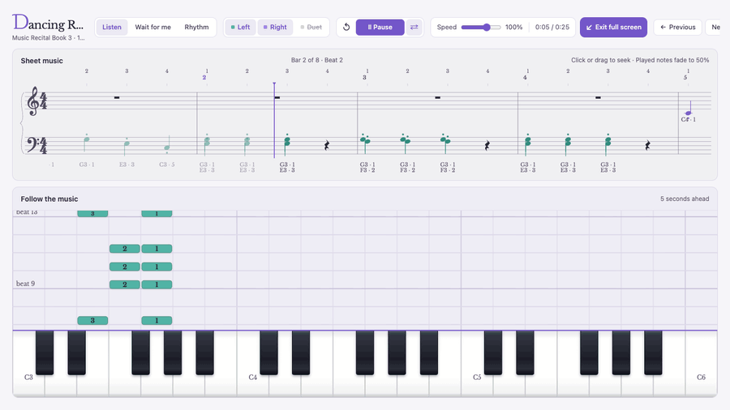
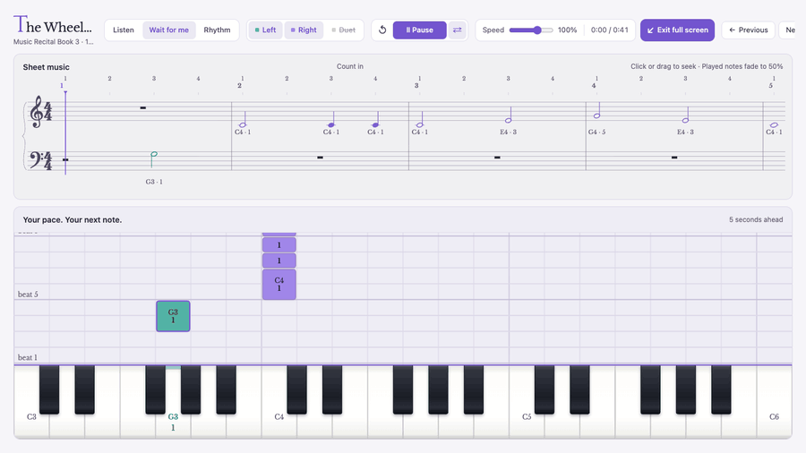
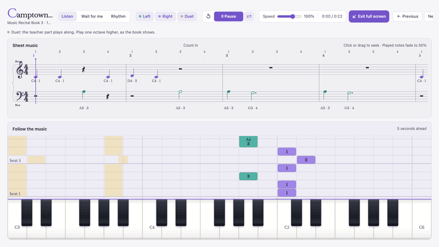

# Paw Pal · MIDI piano practice

[](https://github.com/chickenPopcorn/pawpal/actions/workflows/checks.yml)
[](https://github.com/chickenPopcorn/pawpal/actions/workflows/quality.yml)
[](https://github.com/chickenPopcorn/pawpal/actions/workflows/pages.yml)

A browser piano practice studio: notes fall onto a keyboard, you play them on
your USB piano, and the book's teacher duet plays along.

**Listen**: the app plays your part while the notes fall onto the keys.



**Wait for me**: the music holds at each note until you play it. **Rhythm** keeps going and scores your timing.



**Duet**: the teacher part, in yellow, plays along. The keyboard stays on your part.



## Quick start

Needs Node.js 22.13+ and npm. Use desktop Chrome or Edge for USB MIDI.

```sh
npm ci
```

Put the Supabase project's public values in `.env.local`:

```sh
VITE_SUPABASE_URL=https://ochjekqgxkojrilgsqud.supabase.co
VITE_SUPABASE_PUBLISHABLE_KEY=sb_publishable_...
```

```sh
npm run dev
```

Open `http://localhost:5173`, sign in with Google, and click **Connect your
piano**.

## More docs

- [Practicing](docs/usage.md): the classes, modes, Duet, shortcuts, sound and the practice calendar
- [MIDI and USB pianos](docs/midi.md): connecting, and playing the app's sound on the piano
- [The song library](docs/library.md): `npm run library:pull` and `npm run library:push`
- [Accounts and data](docs/accounts.md): Google sign-in, sync and Supabase setup
- [Development](docs/development.md): scripts, tests and architecture
- [Deployment](docs/deploy.md), including the merge queue, and [GitHub Pages setup](docs/github-pages.md)
- [Verification record](docs/verification.md)
- [Original design brief](docs/cloud-handoff.md)
