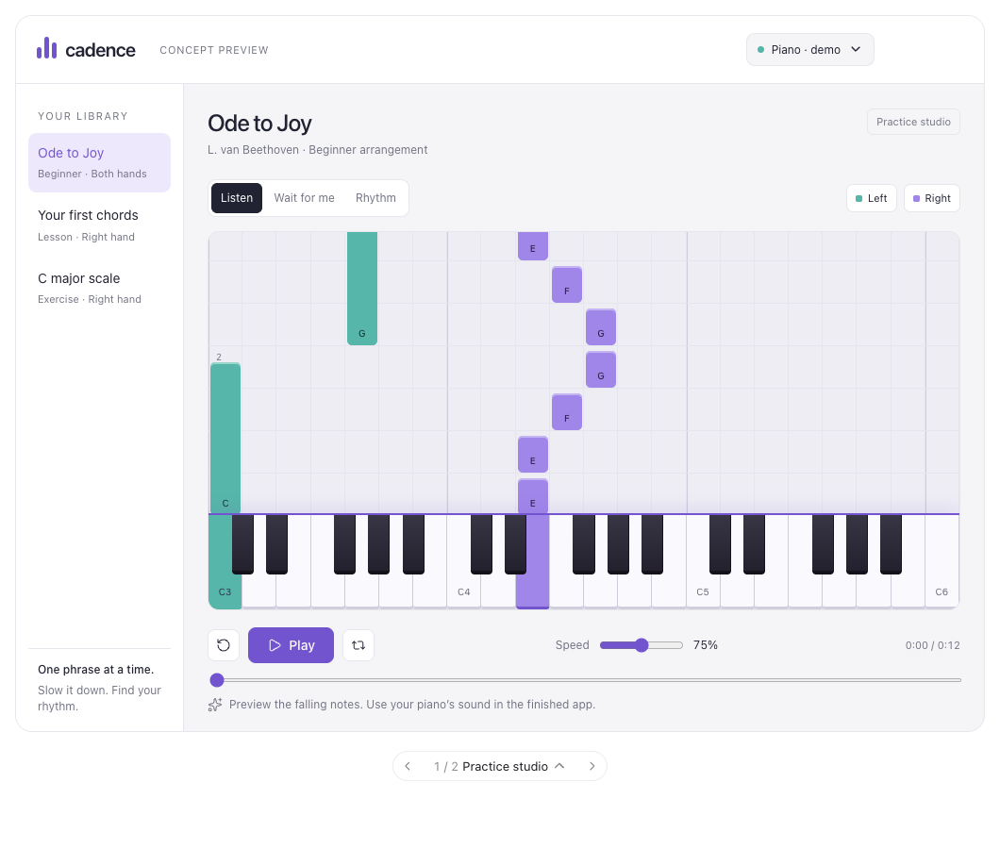
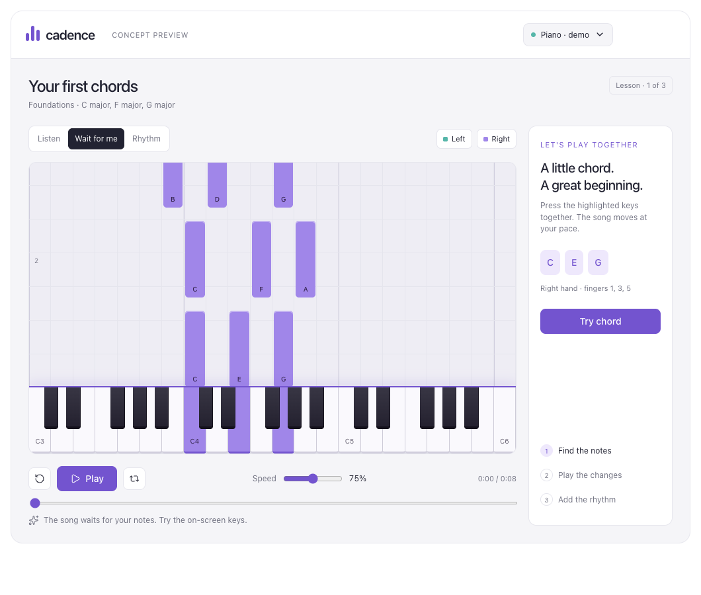

# MIDI Piano

A planned browser piano-learning app with a falling-note waterfall and USB MIDI support for a digital piano.

## Current state

This repository contains the product brief and visual references. **The app has not been implemented.** The design concept uses simulated MIDI and practice controls; it does not demonstrate a working piano connection or practice engine.

## First version

- Desktop Chrome/Edge; connect a USB MIDI piano and show incoming notes and sustain pedal input.
- Import MIDI songs, preserve their tempo maps, and align falling notes with the keyboard.
- Assign tracks to left/right hands, then practise either hand or both.
- Listen, Wait for me, and Rhythm modes, with speed adjustment and passage loops.
- Save practice progress locally, with forgiving, configurable timing feedback.

Use TypeScript, Vite, React, Canvas, Web MIDI, and Web Audio. Keep the practice loop in the browser; a heavy backend is unnecessary. Accounts, billing, and cloud sync are outside the first version.

The deployment target is ChatGPT Sites. Web MIDI permissions must be tested on the actual published URL. Physical USB piano validation must be performed locally and remains unverified until that test is completed.

See [the cloud development handoff](docs/cloud-handoff.md) for milestones and acceptance checks.

## Visual references

The [interactive concept fragment](docs/design/piano-learning-concept.html) is a design reference, not an app entrypoint.

